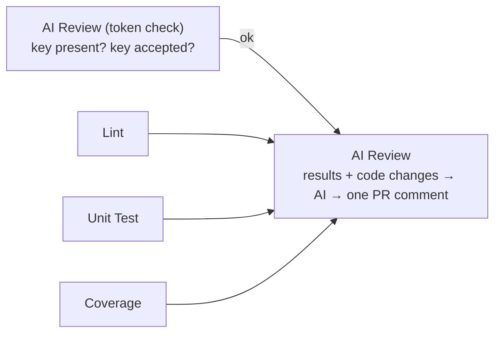
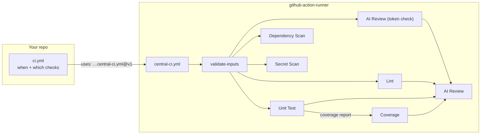
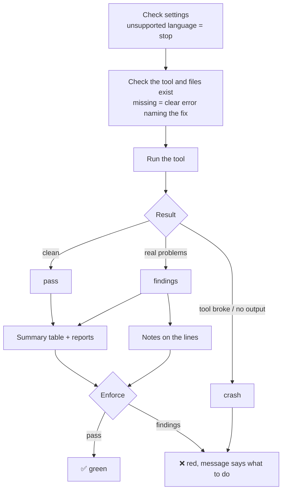

# github-action-runner

Shared CI for every repository in the **DevAnsh-Digital-Solutions** org.

You add **one small file** (`.github/workflows/ci.yml`) to your repo, switch on
the checks you want, and get:

| Check | What it does | Blocks the merge when… |
|---|---|---|
| **Lint** | Checks code style and common mistakes (ESLint / ruff) | it finds an error |
| **Unit tests** | Runs your tests (Jest, Vitest or pytest) | a test fails |
| **Coverage** | Measures how much code your tests run | it is below your threshold (default 80%) |
| **Dependency scan** | Looks for known security holes in your packages | a HIGH or CRITICAL one is found |
| **Secret scan** | Looks for passwords and keys committed by mistake | anything is found |
| **AI review** (optional) | An AI model explains the results above and reviews the code in a PR comment | **never** — it only comments |

All the check logic lives here, so every repo gets the same behaviour, and fixes
reach everyone at once.

**Current version: `v1`** (= `v1.0.0`). Use `@v1` in your `ci.yml`.

---

## Contents

1. [Will it work for my repo?](#1-will-it-work-for-my-repo)
2. [First-time setup (5 steps)](#2-first-time-setup-5-steps)
3. [Pick your scenario (copy-paste)](#3-pick-your-scenario-copy-paste)
4. [Rules for combining checks](#4-rules-for-combining-checks)
5. [Setting up the AI review](#5-setting-up-the-ai-review)
6. [What your project must contain](#6-what-your-project-must-contain)
7. [Reading the results](#7-reading-the-results)
8. [All settings](#8-all-settings)
9. [Troubleshooting](#9-troubleshooting)
10. [Under the hood](#10-under-the-hood) (how it works, security, versions, contributing)

---

## 1. Will it work for my repo?

Check this first. If any row says **No**, the CI will not run for you.

| Your repo is… | Works? | Why / what to do |
|---|---|---|
| A **private** or **internal** repo in the DevAnsh-Digital-Solutions org | ✅ Yes | — |
| A **public** repo | ❌ **No** | This runner repo is private, and GitHub never lets a public repo use workflows from a private one. You get *"workflow was not found"* and **no job runs**. Make your repo private, or ask an org admin to make this runner repo public. |
| A repo **outside the org** (personal account, another org, a fork in your account) | ❌ **No** | Only repos inside this org are allowed. |
| Written in **JavaScript / TypeScript** | ✅ Yes | `language: js` or `ts` |
| Written in **Python** | ✅ Yes | `language: python` |
| Written in **Flutter / Unity** | ❌ Not yet | Accepted as a value, but every check stops with "not yet implemented". |
| Using **self-hosted Windows / macOS / ARM** runners | ❌ No | The tools are Linux x64 only. Use the default `ubuntu-latest`. |
| A **monorepo** (project in a subfolder) | ✅ Yes | Set `working_dir` (see [Scenario 7](#scenario-7-project-in-a-subfolder-monorepo)). |

Two smaller limits, only for the **AI review**:

- It does **not** run on PRs opened **from forks** or by **Dependabot**: GitHub does not give those PRs your secrets.
- It only runs on **pull requests**, not on plain pushes.

---

## 2. First-time setup (5 steps)

**Step 1 — Check access (one time, org admin).** In *this* runner repo:
Settings → Actions → General → **Access** → choose
*"Accessible from repositories in the DevAnsh-Digital-Solutions organization"*.
This is already done for the org; you only need it again if someone changes it.

**Step 2 — Make sure your project has what the checks need.** For example, a
committed lockfile and a test runner. The short list is in
[section 6](#6-what-your-project-must-contain).

**Step 3 — Add the CI file.** Create `.github/workflows/ci.yml` in your repo
and paste one of the [scenarios below](#3-pick-your-scenario-copy-paste).
[Scenario 1](#scenario-1-all-checks-on-every-pr-recommended-start) is the
usual starting point.

**Step 4 — Open a pull request.** The checks appear at the bottom of the PR as
`CI / ci / Lint`, `CI / ci / Unit Test`, and so on. Click **Details** on any of
them, then **Summary**, to see tables of what was found.

**Step 5 (recommended) — Make the checks required.** Settings → Branches →
add a rule for `main` → *Require status checks to pass* → tick the `CI / …`
checks you want to block merges. Don't tick the AI review checks: they are
advice only.

---

## 3. Pick your scenario (copy-paste)

Every scenario is a complete `ci.yml`. Change `language:` to `js`, `ts` or
`python`.

| # | Scenario | Lint | Tests | Coverage | Dep. scan | Secret scan | AI review |
|---|---|:-:|:-:|:-:|:-:|:-:|:-:|
| 1 | [All checks on every PR](#scenario-1-all-checks-on-every-pr-recommended-start) | ✅ | ✅ | ✅ | ✅ | ✅ | – |
| 2 | [Lint only](#scenario-2-lint-only) | ✅ | – | – | – | – | – |
| 3 | [Tests and coverage only](#scenario-3-tests-and-coverage-only) | – | ✅ | ✅ | – | – | – |
| 4 | [Security only](#scenario-4-security-only) | – | – | – | ✅ | ✅ | – |
| 5 | [All checks + AI review on every PR](#scenario-5-all-checks--ai-review-on-every-pr) | ✅ | ✅ | ✅ | ✅ | ✅ | ✅ |
| 6 | [AI review only on PRs into `main`](#scenario-6-ai-review-only-on-prs-into-main) | ✅ | ✅ | ✅ | ✅ | ✅ | `main` only |
| 7 | [Project in a subfolder (monorepo)](#scenario-7-project-in-a-subfolder-monorepo) | ✅ | ✅ | ✅ | ✅ | ✅ | – |
| 8 | [Different checks per branch](#scenario-8-different-checks-per-branch) | ✅ | `main` | `main` | `main` | ✅ | `main` |
| 9 | [Org-recommended full setup (PR + push + nightly)](#scenario-9-org-recommended-full-setup) | ✅ | ✅ | ✅ | ✅ + nightly | ✅ + push to `main` | `main` |

> **Good to know:** every check is **on by default** except the AI review.
> So write `false` for the checks you *don't* want.

### Scenario 1: all checks on every PR (recommended start)

```yaml
name: CI

on:
  pull_request:

permissions:
  contents: read
  security-events: write
  actions: read

jobs:
  ci:
    uses: DevAnsh-Digital-Solutions/github-action-runner/.github/workflows/central-ci.yml@v1
    with:
      language: ts            # js | ts | python
      coverage_threshold: 80  # minimum % of lines your tests must run
```

### Scenario 2: lint only

```yaml
name: CI

on:
  pull_request:

permissions:
  contents: read
  security-events: write
  actions: read

jobs:
  ci:
    uses: DevAnsh-Digital-Solutions/github-action-runner/.github/workflows/central-ci.yml@v1
    with:
      language: ts
      enable_lint: true
      enable_unit_test: false
      enable_coverage: false
      enable_dependency_scan: false
      enable_secret_scan: false
```

### Scenario 3: tests and coverage only

```yaml
name: CI

on:
  pull_request:

permissions:
  contents: read

jobs:
  ci:
    uses: DevAnsh-Digital-Solutions/github-action-runner/.github/workflows/central-ci.yml@v1
    with:
      language: python
      enable_lint: false
      enable_unit_test: true
      enable_coverage: true     # needs enable_unit_test: true
      enable_dependency_scan: false
      enable_secret_scan: false
      coverage_threshold: 70
```

Want tests **without** a coverage gate? Set `enable_coverage: false`.

### Scenario 4: security only

Secret scan and dependency scan on every PR. Nothing else.

```yaml
name: CI

on:
  pull_request:

permissions:
  contents: read
  security-events: write
  actions: read

jobs:
  ci:
    uses: DevAnsh-Digital-Solutions/github-action-runner/.github/workflows/central-ci.yml@v1
    with:
      language: ts
      enable_lint: false
      enable_unit_test: false
      enable_coverage: false
      enable_dependency_scan: true
      enable_secret_scan: true
```

### Scenario 5: all checks + AI review on every PR

First add the `AI_TOKEN` secret ([section 5](#5-setting-up-the-ai-review)).

```yaml
name: CI

on:
  pull_request:

permissions:
  contents: read
  security-events: write
  actions: read
  pull-requests: write        # lets the AI review post its comment

jobs:
  ci:
    uses: DevAnsh-Digital-Solutions/github-action-runner/.github/workflows/central-ci.yml@v1
    with:
      language: ts
      enable_llm_review: true
      llm_provider: gemini           # see section 5 for OpenAI, Claude, others
      llm_model: gemini-2.5-flash
    secrets:
      ai_token: ${{ secrets.AI_TOKEN }}
```

### Scenario 6: AI review only on PRs into `main`

Same as Scenario 5, but the AI review only runs when the PR **targets** `main`.
PRs into other branches still get all the normal checks.

```yaml
name: CI

on:
  pull_request:

permissions:
  contents: read
  security-events: write
  actions: read
  pull-requests: write

jobs:
  ci:
    uses: DevAnsh-Digital-Solutions/github-action-runner/.github/workflows/central-ci.yml@v1
    with:
      language: python
      enable_llm_review: ${{ github.base_ref == 'main' }}
      llm_provider: openai-compatible
      llm_model: gpt-4o
    secrets:
      ai_token: ${{ secrets.AI_TOKEN }}
```

Other ways to pick branches — replace the `enable_llm_review` line:

| You want the AI review on PRs into… | Write |
|---|---|
| every branch | `enable_llm_review: true` |
| one branch, e.g. `develop` | `enable_llm_review: ${{ github.base_ref == 'develop' }}` |
| a few branches | `enable_llm_review: ${{ contains(fromJSON('["main","develop"]'), github.base_ref) }}` |
| every `release/…` branch | `enable_llm_review: ${{ startsWith(github.base_ref, 'release/') }}` |

The same trick works for **any** `enable_…` flag.

### Scenario 7: project in a subfolder (monorepo)

If your code is in, say, `services/api/` instead of the repo root:

```yaml
name: CI

on:
  pull_request:

permissions:
  contents: read
  security-events: write
  actions: read

jobs:
  api:
    uses: DevAnsh-Digital-Solutions/github-action-runner/.github/workflows/central-ci.yml@v1
    with:
      language: ts
      working_dir: services/api
```

Two projects in one repo? Add a second job (for example `web:` with
`working_dir: apps/web`). Give each job a different name.

### Scenario 8: different checks per branch

Quick checks on feature branches, everything on PRs into `main`:

```yaml
name: CI

on:
  pull_request:

permissions:
  contents: read
  security-events: write
  actions: read
  pull-requests: write

jobs:
  ci:
    uses: DevAnsh-Digital-Solutions/github-action-runner/.github/workflows/central-ci.yml@v1
    with:
      language: ts
      enable_lint: true                                       # every PR
      enable_secret_scan: true                                # every PR
      enable_unit_test: ${{ github.base_ref == 'main' }}      # PRs into main
      enable_coverage: ${{ github.base_ref == 'main' }}       # PRs into main
      enable_dependency_scan: ${{ github.base_ref == 'main' }}
      enable_llm_review: ${{ github.base_ref == 'main' }}
      llm_provider: gemini
      llm_model: gemini-2.5-flash
    secrets:
      ai_token: ${{ secrets.AI_TOKEN }}
```

> The org's [check policy](docs/CHECK-POLICY.md) asks for lint, tests and
> coverage on **every** PR. Use this scenario only if your team agrees, and
> make sure everything reaching `main` gets the full set.

For rules that depend on both the event and the branch, see
[policy job pattern](#policy-job-pattern-advanced).

### Scenario 9: org-recommended full setup

This matches [docs/CHECK-POLICY.md](docs/CHECK-POLICY.md): all checks on
every PR, AI review on PRs into `main`, secret scan again after merging to
`main`, and a nightly dependency scan (to catch newly published
vulnerabilities in code that was already merged).

```yaml
name: CI

on:
  pull_request:
  push:
    branches: [main]
  schedule:
    - cron: '0 3 * * *'   # every night at 03:00 UTC (runs on the default branch)

permissions:
  contents: read
  security-events: write
  actions: read
  pull-requests: write

jobs:
  pr-checks:
    if: github.event_name == 'pull_request'
    uses: DevAnsh-Digital-Solutions/github-action-runner/.github/workflows/central-ci.yml@v1
    with:
      language: ts
      coverage_threshold: 80
      enable_llm_review: ${{ github.base_ref == 'main' }}
      llm_provider: gemini
      llm_model: gemini-2.5-flash
    secrets:
      ai_token: ${{ secrets.AI_TOKEN }}

  after-merge-secret-scan:
    if: github.event_name == 'push'
    uses: DevAnsh-Digital-Solutions/github-action-runner/.github/workflows/central-ci.yml@v1
    with:
      language: ts
      enable_lint: false
      enable_unit_test: false
      enable_coverage: false
      enable_dependency_scan: false
      enable_secret_scan: true

  nightly-dependency-scan:
    if: github.event_name == 'schedule'
    uses: DevAnsh-Digital-Solutions/github-action-runner/.github/workflows/central-ci.yml@v1
    with:
      language: ts
      enable_lint: false
      enable_unit_test: false
      enable_coverage: false
      enable_dependency_scan: true
      enable_secret_scan: false
```

More language-specific examples: [docs/consumers/typescript.md](docs/consumers/typescript.md),
[docs/consumers/python.md](docs/consumers/python.md).

---

## 4. Rules for combining checks

| Rule | What happens if you break it |
|---|---|
| **Coverage needs unit tests.** Coverage reads the test run's report; it never runs tests itself. | The run stops at once with *"enable_coverage requires enable_unit_test"*. |
| **AI review needs** `AI_TOKEN`, `llm_model`, and `pull-requests: write`. | The *AI Review (token check)* job fails with a message naming what's missing. Your other checks are not affected. |
| **AI review only runs on pull requests.** | On a push it is skipped with a notice. |
| **AI review reads lint, tests and coverage.** It does not read the dependency or secret scan. | If those three are off, it reviews only the code changes. |
| **Every check except the AI review is on by default.** | Leaving a flag out means *on*. Write `false` to turn a check off. |
| **One check alone is fine.** Turning on just one check runs just that check. | — |
| **Lint, dependency scan and secret scan need** `security-events: write` and `actions: read`. | They fail to upload their results. Copy the `permissions:` block from the scenarios. |

---

## 5. Setting up the AI review

The AI review sends the pull request's code changes, plus the lint, test and
coverage results, to an AI model. It then posts **one comment** on the PR with
a verdict and a to-do list. It **never blocks** a merge.

### Step 1: get an API key and save it as a secret

1. Get a key from your provider (for example
   [Google AI Studio](https://aistudio.google.com/apikey) for Gemini, or
   [OpenAI](https://platform.openai.com/api-keys)).
2. In your repo: Settings → Secrets and variables → Actions → **New repository
   secret**.
3. Name: **`AI_TOKEN`**. Value: **only the key** — no quotes, no spaces.

### Step 2: choose the provider and model

Copy the two (or three) lines for your provider into `with:`:

| Provider | Lines to add |
|---|---|
| **Google Gemini** | `llm_provider: gemini`<br>`llm_model: gemini-2.5-flash` |
| **OpenAI** | `llm_provider: openai-compatible`<br>`llm_model: gpt-4o` |
| **Anthropic Claude** | `llm_provider: anthropic`<br>`llm_model:` *a Claude model name* |
| **Groq, OpenRouter, Mistral, DeepSeek, Together, Ollama, LiteLLM…** | `llm_provider: openai-compatible`<br>`llm_base_url:` *that provider's API address*<br>`llm_model:` *its model name* |

- `llm_model` has **no default**: write the exact name your provider uses.
- Only set `llm_base_url` for the last row. Do **not** set it for `gemini`,
  `anthropic` or plain OpenAI — a wrong address gives an HTTP 404.

### Step 3: turn it on and pass the secret

```yaml
    with:
      enable_llm_review: true      # or a branch rule, see Scenario 6
      llm_provider: gemini
      llm_model: gemini-2.5-flash
    secrets:
      ai_token: ${{ secrets.AI_TOKEN }}   # or replace the whole block with: secrets: inherit
```

And add `pull-requests: write` under `permissions:` (see Scenario 5).

### What happens on a PR



1. **AI Review (token check)** runs first, in a few seconds. If the key is
   missing or wrong, it stops here with a clear message — before any code is
   sent anywhere.
2. Lint, tests and coverage run as usual.
3. When they finish (**pass or fail**), **AI Review** sends the results and the
   code changes to the model and posts the comment.

### What the comment looks like

```text
🤖 AI review
Verdict: ❌ Needs changes — 1 high · 2 medium

| Check      | Result | Details                          |
| Lint       | ✅     | no findings                      |
| Unit tests | ✅     | 12 passed, 0 failed (12 total)   |
| Coverage   | ❌     | 66.67% lines vs 80% required     |

1. Lint          ✅ Nothing to flag.
2. Unit tests    ✅ Nothing to flag.
3. Coverage
   - [ ] 🔴 High · src/multiply.ts — no tests cover this file
         💡 Fix: add a test that calls multiply()
4. Code review
   - [ ] 🟠 Medium · .github/workflows/ci.yml:4 — push trigger removed
         💡 Fix: …
```

- The **results table** comes from the real check output, not from the AI.
- Each point is a **checkbox** you can tick as you fix it.
- There is **one comment per PR**. Each new push **edits** that same comment
  (it shows "edited"); GitHub does not send a notification for edits, and
  ticked boxes reset.
- The full review is also on the run's **Summary** page.

### Before using it on real projects

- **Your code leaves GitHub.** The PR's changes are sent to the provider you
  choose. Check that your clients' contracts allow that. Google's **free**
  Gemini tier may use what you send to improve its products; use a paid tier
  for private code.
- **It costs money** per push on every reviewed PR. Limiting it to PRs into
  `main` (Scenario 6) keeps the cost down.
- **AI can be wrong.** Treat it as a second pair of eyes, never as the
  reason to merge.

---

## 6. What your project must contain

The CI uses **your** tools at **your** versions; it never installs extra ones.

**JavaScript / TypeScript**

| For | You need |
|---|---|
| any check | a committed lockfile: `package-lock.json`, `pnpm-lock.yaml` or `yarn.lock` |
| lint | an ESLint config file and `eslint` in `devDependencies` |
| unit tests | `jest` **or** `vitest` (not both) in `devDependencies` |
| coverage | Jest: nothing extra. Vitest: `@vitest/coverage-v8` |

**Python**

| For | You need |
|---|---|
| any check | `requirements.txt` (preferred) or `pyproject.toml` (with dev tools in a `dev` extra) |
| lint | `ruff` installed |
| unit tests | `pytest` installed and at least one `test_*.py` file |
| coverage | `pytest-cov` installed, and `[tool.coverage.run] source = ["src"]` |
| dependency scan | exact versions (`==`) for **every** package, e.g. from `pip freeze`, or a `poetry.lock` / `Pipfile.lock` |

A minimal Python `pyproject.toml` that works:

```toml
[tool.ruff]
line-length = 100

[tool.pytest.ini_options]
testpaths = ["tests"]
pythonpath = ["src"]

[tool.coverage.run]
source = ["src"]
branch = true
```

---

## 7. Reading the results

| Where | What you see |
|---|---|
| **PR → checks list** | One line per check: ✅ passed, ❌ failed, ⊘ skipped (turned off) |
| **PR → conversation** | The AI review comment (if on) |
| **PR → Files changed** | Notes on the exact lines with problems (up to 15 per check) |
| **Check → Details → Summary** | A table for each check: what was found, test totals, coverage %, vulnerable packages |
| **Check → Details → last step** | Why it failed and what to do next |
| **Run → Artifacts** | Downloadable full reports (`lint-sarif`, `coverage-report`, `llm-review`, …) |
| **Security → Code scanning** | Lint and scan findings, if your plan includes GitHub Code Security |

On a **private repo without GitHub Code Security**, an *Upload SARIF* step
shows a warning and carries on. That is normal; all results are still in the
summary and artifacts.

---

## 8. All settings

Everything goes under `with:` in your `ci.yml`.

**Main settings**

| Setting | Default | What it does |
|---|---|---|
| `language` | *required* | `js`, `ts` or `python` |
| `working_dir` | `.` | Folder of your project inside the repo |
| `enable_lint` | `true` | Lint check on/off |
| `enable_unit_test` | `true` | Unit tests on/off |
| `enable_coverage` | `true` | Coverage gate on/off (needs unit tests) |
| `enable_dependency_scan` | `true` | Dependency scan on/off |
| `enable_secret_scan` | `true` | Secret scan on/off |
| `coverage_threshold` | `80` | Minimum % of lines your tests must run |
| `python_version` | `3.12` | Python version (Python projects only) |
| `runner_label` | `ubuntu-latest` | Machine type; must be Linux x64 |

**AI review settings**

| Setting | Default | What it does |
|---|---|---|
| `enable_llm_review` | `false` | AI review on/off |
| `llm_provider` | `openai-compatible` | `gemini`, `openai-compatible` or `anthropic` |
| `llm_model` | *none — required* | Exact model name |
| `llm_base_url` | the provider's own | Only for other OpenAI-compatible providers |
| `llm_max_findings` | `20` | Most points in the comment |
| `llm_max_diff_kb` | `200` | Largest code change sent; bigger ones are cut (the comment says so) |
| `llm_exclude_paths` | lockfiles, `dist/**`, `build/**`, `coverage/**`, `*.min.js`, `*.map` | Files never sent to the AI (comma-separated) |
| `llm_timeout_seconds` | `120` | How long to wait for the AI |
| `llm_max_output_tokens` | `4096` | Reply length limit (used by Anthropic only) |

**Secret:** `ai_token` — only needed for the AI review.

**Fixed for now** (not changeable from `ci.yml` yet): ESLint fails on errors
only (not warnings); the dependency scan blocks on HIGH and CRITICAL; tests and
coverage files are auto-detected; Node.js 20; Python dev extra `dev`.

---

## 9. Troubleshooting

| You see | Why | Fix |
|---|---|---|
| *"workflow was not found"* and **no jobs run** | Your repo is **public**, outside the org, or the access setting is off | See [section 1](#1-will-it-work-for-my-repo) and Step 1 of [setup](#2-first-time-setup-5-steps) |
| `unsupported language '…'` | Typo in `language` | Use `js`, `ts` or `python` |
| `language 'flutter' is not yet implemented` | Not built yet | Turn the check off or wait for that phase |
| `enable_coverage requires enable_unit_test` | Coverage on, tests off | Turn tests on, or coverage off |
| `no lockfile found` | No lockfile committed | Commit `package-lock.json` / `pnpm-lock.yaml` / `yarn.lock` |
| `no Python dependency file found` | No `requirements.txt` / `pyproject.toml` | Commit the file the message names |
| `required command 'ruff' not found` / `pytest is not installed` | Tool missing from your dependencies | Add it to `requirements.txt` |
| `pytest collected no tests` | No `test_*.py` files found | Add tests, or fix `testpaths` |
| Coverage: `no coverage file was produced` | `pytest-cov` missing, or tests crashed | Add `pytest-cov`; look at the Unit Test job |
| Coverage lower than expected | Tests themselves are being counted | Set `[tool.coverage.run] source = ["src"]` |
| Lint says *crash*, not *findings* | Broken linter config | Read the *Run linter* step |
| Dependency scan misses a known issue | Version ranges in `requirements.txt` | Pin exact versions (`pip freeze`) or use a lockfile |
| *Upload SARIF* warning about Advanced Security | Private repo without Code Security | Normal, nothing to do |
| `AI_TOKEN is not set` | Secret missing, not passed (`secrets:`), or PR from a fork / Dependabot | Add the secret and the `secrets:` block |
| `AI_TOKEN was rejected` / HTTP 401 / "API key not valid" | Wrong or expired key, or key for another provider | Make a new key and update the secret |
| AI Review: HTTP 404 | Wrong `llm_model`, or an `llm_base_url` that doesn't match `llm_provider` | Fix the model name; remove `llm_base_url` for `gemini` / `anthropic` / OpenAI |
| AI Review: HTTP 429 / quota | Rate limit or no credit left | Wait and re-run, or add billing credit |
| `llm_model is empty` | AI review on without a model | Add `llm_model` |
| AI review ran, but no comment | Missing `pull-requests: write`, or a fork PR | Add the permission; the review is still on the Summary page |
| AI review says *"no output available"* for a check | That check crashed before saving its report | Open that check's log |
| "I pushed but the AI comment didn't change" | It **edits** the same comment | Scroll up to the comment; it shows "edited" and the new commit at the bottom |

---

## 10. Under the hood

### How it works

Your `ci.yml` decides **when** CI runs and **which** checks are on. It calls
[`central-ci.yml`](.github/workflows/central-ci.yml), which checks your
settings and starts one job per check. Each job runs one action from
[`.github/actions/`](.github/actions).



Every check behaves the same way:



A **finding** is a real problem in your code. A **crash** is a setup problem
(bad config, missing tool, network). Both fail the check, and the message says
which one it was. A check never passes just because a tool was missing.

### What each check uses

| Check | JS / TS | Python | Notes |
|---|---|---|---|
| Lint | ESLint | `ruff check` | Uses your own config |
| Unit tests | Jest or Vitest (auto-detected) | `pytest` | Failing tests are listed with their messages |
| Coverage | lcov / Istanbul summary | `pytest-cov` | Gates on **lines**; branches are reported only |
| Dependency scan | osv-scanner on the lockfile | osv-scanner on `requirements.txt` / `poetry.lock` / `Pipfile.lock` | Duplicate advisories are merged into one row; the failure message shows the fix command |
| Secret scan | Gitleaks | Gitleaks | PRs: only the PR's commits. Push: history of the pushed commit. Values are always hidden |

### Policy job pattern (advanced)

When the checks depend on **both** the event (PR, push, nightly) and the
branch, a small `policy` job can turn them into one true/false per check,
which a single `ci` job then passes on. `python-private` uses this; see its
`ci.yml` for the full version.

```yaml
jobs:
  policy:
    runs-on: ubuntu-latest
    permissions: {}
    outputs:
      lint: ${{ steps.resolve.outputs.lint }}
      full: ${{ steps.resolve.outputs.full }}
    steps:
      - id: resolve
        shell: bash
        env:
          EVENT: ${{ github.event_name }}
          TARGET: ${{ github.event_name == 'pull_request' && github.base_ref || github.ref_name }}
        run: |
          set -euo pipefail
          lint=false; full=false
          case "${EVENT}:${TARGET}" in
            pull_request:main|push:main) lint=true; full=true ;;
            pull_request:dev|push:dev)   lint=true ;;
          esac
          printf '%s\n' "lint=$lint" "full=$full" >> "$GITHUB_OUTPUT"

  ci:
    needs: policy
    if: needs.policy.outputs.lint == 'true'
    uses: DevAnsh-Digital-Solutions/github-action-runner/.github/workflows/central-ci.yml@v1
    with:
      language: python
      enable_lint: true
      enable_unit_test: ${{ needs.policy.outputs.full == 'true' }}
      enable_coverage: ${{ needs.policy.outputs.full == 'true' }}
      enable_dependency_scan: ${{ needs.policy.outputs.full == 'true' }}
      enable_secret_scan: ${{ needs.policy.outputs.full == 'true' }}
```

### Permissions and security

- Your `ci.yml`'s `permissions:` is the **maximum** the checks can use; each
  job asks for less. Lint and the scans need `security-events: write` and
  `actions: read`; the AI review needs `pull-requests: write`. Nothing ever
  gets `contents: write`.
- Every third-party action is pinned to an exact commit. Downloaded tools
  (osv-scanner, gitleaks) are checked against a known SHA-256 before running.
- Settings and PR data reach scripts only through environment variables,
  never pasted into commands. `pull_request_target` is never used.
- Secret-scan results always hide the matched value.
- `AI_TOKEN` is sent only in a request header, only to an `https://` address,
  and is removed from every error message. PR content is treated as untrusted:
  the AI is told to ignore instructions inside it, its reply must match a
  fixed format, and the posted text is cleaned (HTML escaped, `@mentions` and
  links disabled, file references checked against the real changes).

### Versions

| Use | When |
|---|---|
| `@v1` | **Recommended.** Always the latest `v1.x.y`; you get fixes automatically. |
| `@v1.0.0` | You want nothing to change until you update it yourself. |
| `@main` | Don't — it can change at any time. |
| `@v1.1.0-rc.*` | Don't — old test versions from before `v1.0.0`. |

A breaking change gets a new major version (`v2`); `v1` keeps working.

**Releasing (maintainers).** `central-ci.yml` refers to its own actions by tag
(a local `./` path would point inside *your* repo, and `uses:` can't take a
variable), so every release edits those lines:

1. Make and test the change on a branch (unit tests, `self-check` green).
2. Set every internal `uses: …@vX.Y.Z` in `central-ci.yml` to the new tag.
3. Commit, tag (e.g. `v1.0.1`, or `v1.1.0-rc.1` for a test version), push.
4. Test on a real consumer repo: a passing PR and a deliberately failing one.
5. With approval: merge to `main`, then move `v1` to the new tag.

Merging to `main` and moving `v1` always need human approval.

### Working on this repo

Read [CLAUDE.md](CLAUDE.md) first: one action per check, language handled with
a `case` inside each action, `set -euo pipefail` in every shell step, clear
error messages, pinned actions, minimal permissions, and a comment header on
every `action.yml`.

Run the unit tests (Node 20+ and bash):

```bash
for t in tests/test_*.mjs; do node "$t"; done; bash tests/test_lib.sh
```

Lint the YAML and shell. `self-check.yml` runs actionlint and shellcheck on
every PR to this repo. Locally:

```bash
actionlint
```

(`self-check.yml` does not run the unit tests yet, so run them before
pushing.)

**Adding a language** means adding a branch to the `case` in each action,
extending `scripts/` and `tests/` if a new report format appears, and adding
`docs/consumers/<language>.md`. It is done only when tested on a real consumer
repo, with both a passing and a deliberately failing PR for every check.

### Roadmap

| Phase | Scope | State |
|---|---|---|
| 1 | JS / TS: lint, tests, coverage, dependency scan, secret scan | Released in `v1.0.0` |
| 2 | Python: the same five checks | Released in `v1.0.0` |
| 2+ | Advisory AI review | Released in `v1.0.0` |
| 3 | Flutter | Not started |
| 4 | Unity | Not started |
| later | SAST, IaC scan, SBOM | Not started; rules already in [CHECK-POLICY.md](docs/CHECK-POLICY.md) |

Full release notes: [CHANGELOG.md](CHANGELOG.md).
