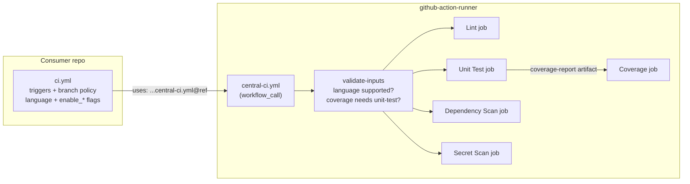
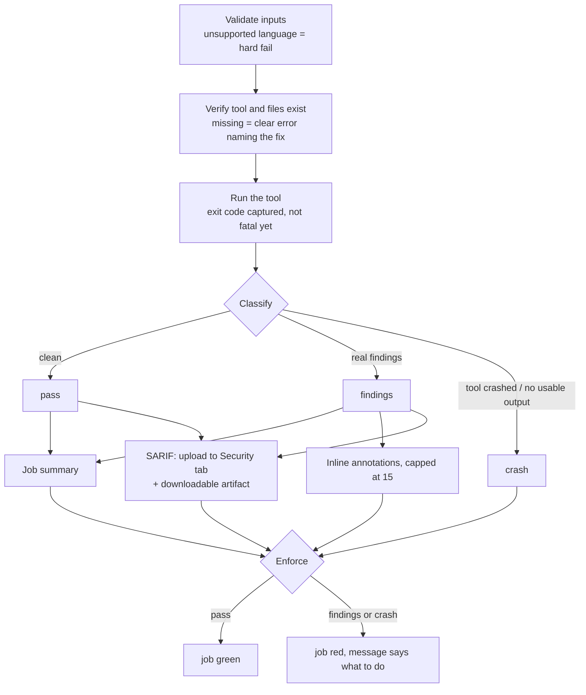
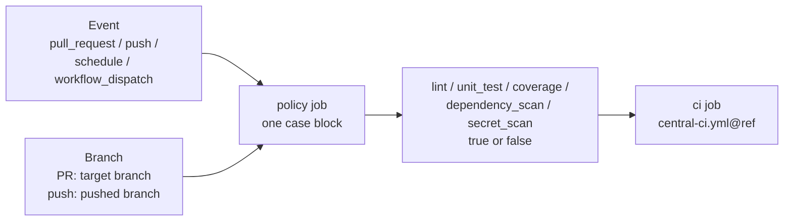
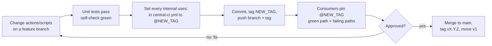

# github-action-runner

Central CI for every repository in the **DevAnsh-Digital-Solutions** org.

A consumer repo adds one small `ci.yml` that calls this repo's reusable
workflow, turns on the checks it wants with boolean flags, and gets lint,
unit tests, coverage gating, dependency scanning and secret scanning with
consistent behaviour, summaries and SARIF output across the org. The checks
themselves live here, so they are written, reviewed, pinned and upgraded in
one place.

This repo holds **no application code**: only CI definitions, the helper
scripts they call, and tests for those scripts. Engineering rules for
changing it are in [CLAUDE.md](CLAUDE.md); which check runs when, and
whether it blocks, is in [docs/CHECK-POLICY.md](docs/CHECK-POLICY.md).

---

## Contents

- [Status and versions](#status-and-versions)
- [How it works](#how-it-works)
- [Quick start](#quick-start)
- [Inputs](#inputs)
- [The checks](#the-checks)
- [What your project must provide](#what-your-project-must-provide)
- [Branch and trigger policy](#branch-and-trigger-policy)
- [Reading the results](#reading-the-results)
- [Permissions and security](#permissions-and-security)
- [Versioning and releases](#versioning-and-releases)
- [Troubleshooting](#troubleshooting)
- [Repository layout](#repository-layout)
- [Working on this repo](#working-on-this-repo)
- [Roadmap](#roadmap)

---

## Status and versions

| Language | Status | Available at |
|---|---|---|
| `js` / `ts` | Implemented (Phase 1) | `@main`, `@v1.1.0-rc.2` |
| `python` | Implemented (Phase 2), **pre-release, under validation** | `@v1.1.0-rc.2` only |
| `flutter` | Not started. Accepted as a value, every check hard-fails with "not yet implemented" | n/a |
| `unity` | Not started. Same as flutter | n/a |

| Ref | What it is |
|---|---|
| `v1.1.0-rc.2` | **Current pre-release.** JS/TS + Python. Use this to test Python. |
| `v1.1.0-rc.1` | Superseded: its secret scan failed pushes to `main` when *another* branch held a secret. Do not use. |
| `main` | Phase 1 (JS/TS only). |
| `v1` / `v1.x.y` | **Not created yet.** No stable release has been tagged. Docs that say `@v1` describe the intended steady state. |

Build order is TS/JS → Python → Flutter → Unity; a language is not started
until the previous one is reviewed and approved.

---

## How it works

A consumer's `ci.yml` decides *when* CI runs and *which* checks are on. It
calls [`central-ci.yml`](.github/workflows/central-ci.yml), which validates
the inputs and starts one job per enabled check. Each job checks out the
consumer repo, installs its toolchain with the `setup` action, and runs one
composite action from [`.github/actions/`](.github/actions).



Every check job except Secret Scan first runs the
[`setup`](.github/actions/setup/action.yml) action (Node.js or Python plus
the project's own dependencies), then its check action. Jobs whose flag is
`false` are skipped and never start a runner.

### Inside one check

Every check action follows the same shape, so all of them fail, summarise and
report the same way:



A **finding** is a real problem in your code (a lint error, a failing test, a
vulnerable package). A **crash** is an infrastructure problem (bad config,
network failure, missing tool). Both fail the job, but the message tells you
which one it was. Nothing ever passes because a tool was missing or produced
no output.

---

## Quick start

**1. Give the consumer access (private runner repo only).** In *this* repo:
Settings → Actions → General → **Access** → "Accessible from repositories in
the DevAnsh-Digital-Solutions organization". Without it, consumer runs fail
with *workflow was not found*.

**2. Make sure your project has what its checks need.** See
[What your project must provide](#what-your-project-must-provide).

**3. Add `.github/workflows/ci.yml` to the consumer repo:**

```yaml
name: CI

on:
  pull_request:
  push:
    branches: [main]

# Ceiling for the central workflow's per-job permissions: checkout needs
# contents:read; the SARIF upload needs security-events:write + actions:read.
permissions:
  contents: read
  security-events: write
  actions: read

jobs:
  ci:
    uses: DevAnsh-Digital-Solutions/github-action-runner/.github/workflows/central-ci.yml@v1.1.0-rc.2
    with:
      language: python          # js | ts | python
      enable_lint: true
      enable_unit_test: true
      enable_coverage: true     # requires enable_unit_test: true
      enable_dependency_scan: true
      enable_secret_scan: true
      coverage_threshold: 80
```

**4. Open a pull request.** The checks appear as `CI / Lint`,
`CI / Unit Test` and so on. Open the run's **Summary** page for the tables.

**5. Make the checks required (optional, recommended).** Settings → Branches
→ branch protection for `main` → *Require status checks to pass* → pick the
`CI / …` checks.

Copy-paste variants (lint-only, security-only, full suite with nightly scan)
are in [docs/consumers/typescript.md](docs/consumers/typescript.md) and
[docs/consumers/python.md](docs/consumers/python.md). Those pages show
`@v1`; until `v1` exists, use `@v1.1.0-rc.2`.

---

## Inputs

All inputs go under `with:` in the consumer's `ci.yml`.

| Input | Type | Default | Description |
|---|---|---|---|
| `language` | string | *required* | `js`, `ts`, `python`, `flutter` or `unity`. Anything else fails `validate-inputs` with the supported list. |
| `working_dir` | string | `.` | Project directory, relative to the repo root (for monorepos). |
| `runner_label` | string | `ubuntu-latest` | Runner every job uses. The tooling assumes Linux x64. |
| `enable_lint` | boolean | `true` | Run the lint check. |
| `enable_unit_test` | boolean | `true` | Run the unit tests. Must be `true` when `enable_coverage` is `true`. |
| `enable_coverage` | boolean | `true` | Gate on line coverage. Parses the unit-test job's report; never runs tests itself. |
| `enable_dependency_scan` | boolean | `true` | Run the dependency (SCA) scan. |
| `enable_secret_scan` | boolean | `true` | Run the secret scan. Language-agnostic. |
| `coverage_threshold` | number | `80` | Minimum **line** coverage, in percent. |
| `python_version` | string | `3.12` | Python installed when `language: python`. Ignored otherwise. |

Every flag defaults to `true`, so **set the ones you don't want to `false`
explicitly**. Enabling exactly one check runs exactly that check (plus
`validate-inputs`). The one dependency is that coverage needs unit tests.

The composite actions have a few more inputs that `central-ci.yml` does not
expose yet. They run with these defaults:

| Action | Input | Default used |
|---|---|---|
| lint | `fail_on` | `error` (ESLint warnings don't fail; any ruff finding fails) |
| dependency-scan | `severity_threshold` | `HIGH` (blocks on HIGH and CRITICAL) |
| unit-test | `test_command` | auto-detect |
| coverage | `coverage_file` | auto-detect |
| setup | `node_version` | `20` |
| setup | `pip_extras` | `dev` |

---

## The checks

| Check | `js` / `ts` | `python` | Blocks on | Output |
|---|---|---|---|---|
| **Lint** | ESLint | `ruff check` | any finding at/above `fail_on` | summary table, annotations, `lint-sarif` |
| **Unit test** | Jest or Vitest (auto-detected) | `pytest` | a failing test; no tests collected; runner missing | summary table, annotations per failing test (python) |
| **Coverage** | lcov or Istanbul json-summary | `pytest-cov` Cobertura XML | line coverage < `coverage_threshold` | summary table (lines / branches / functions) |
| **Dependency scan** | `osv-scanner` on the lockfile | `osv-scanner` on `requirements.txt` / `poetry.lock` / `Pipfile.lock` | a HIGH or CRITICAL vulnerability | counts table, per-package table, annotations, `dependency-scan-sarif` |
| **Secret scan** | Gitleaks | Gitleaks | any finding | findings table (values redacted), `secret-scan-sarif` |

Details worth knowing:

- **Tools come from your project.** ESLint, Jest/Vitest, ruff, pytest and
  pytest-cov must be in your own `package.json` / `requirements.txt`. The
  setup action installs exactly what you pin and nothing else, so CI runs
  the same versions developers do. The exceptions are `osv-scanner` and
  `gitleaks`, which this repo downloads as pinned, SHA-256-verified binaries.
- **Lint uses your config.** ESLint without a committed config fails with a
  message saying so (the action never writes one). ruff uses the rules in
  your `pyproject.toml` / `ruff.toml`, or ruff's defaults if there are none.
- **Coverage gates on lines only.** Branches are reported; functions show
  `N/A` for Python, because Cobertura has no function metric.
- **Dependency scan merges duplicates.** One flaw published as GHSA-, PYSEC-
  and CVE- records is one row. Advisories with no usable severity are listed
  as `UNKNOWN` and never block. A failing scan prints this table, highest
  severity first, in the summary *and* under the failure message in the
  *Enforce* step's log, together with the command to fix it:

  | Severity | Package | Installed | Vulnerability | Fixed in |
  |---|---|---|---|---|
  | HIGH | urllib3 | 1.26.4 | GHSA-q2q7-5pp4-w6pg (CVE-2021-33503) | 1.26.5 |

- **Secret scan range.** On `pull_request` it scans only the PR's commits
  (`base..head`). On `push` it scans the full history *reachable from the
  pushed commit*, not other branches. Matched values are always redacted
  in logs, the summary and the SARIF.

---

## What your project must provide

### JS / TS

| Needed for | What |
|---|---|
| setup | A committed lockfile: `package-lock.json`, `pnpm-lock.yaml` or `yarn.lock` |
| lint | An ESLint config (`eslint.config.*`, `.eslintrc*` or `"eslintConfig"` in `package.json`) and `eslint` as a devDependency |
| unit test | `jest` **or** `vitest` (both at once is an error), as a devDependency or via its config file |
| coverage | Jest: built in. Vitest: `@vitest/coverage-v8` or `@vitest/coverage-istanbul` |

### Python

| Needed for | What |
|---|---|
| setup | `requirements.txt` (preferred) or `pyproject.toml`. With only `pyproject.toml`, the project is installed with `pip install -e ".[dev]"`, so put the dev tools in a `dev` extra. |
| lint | `ruff` installed; rules in `[tool.ruff]` |
| unit test | `pytest` installed and at least one test (`test_*.py`) |
| coverage | `pytest-cov` installed; `[tool.coverage.run] source = ["src"]` so tests don't count toward coverage |
| dependency scan | Exact pins (`==`), **transitive dependencies included** (for example `pip freeze > requirements.txt`), or a `poetry.lock` / `Pipfile.lock`. osv-scanner reads `requirements.txt` literally and does not resolve ranges. |

A minimal Python layout that passes every check:

```
pyproject.toml        ruff, pytest and coverage config
requirements.txt      pinned: your deps + ruff, pytest, pytest-cov
src/<package>/...
tests/test_*.py
```

```toml
[tool.ruff]
line-length = 100

[tool.pytest.ini_options]
testpaths = ["tests"]
pythonpath = ["src"]      # tests import the package without installing it

[tool.coverage.run]
source = ["src"]
branch = true
```

---

## Branch and trigger policy

**This repo is branch-agnostic by design.** It never looks at branch names.
Each consumer decides in its own `ci.yml` which events and branches run which
checks. The org default comes from [docs/CHECK-POLICY.md](docs/CHECK-POLICY.md):

| Check | Runs on | Blocking? |
|---|---|---|
| Lint, unit tests, coverage | every PR, all target branches | yes |
| Secret scan | every PR + push to `main` | yes |
| Dependency scan | every PR + nightly on `main` | on HIGH / CRITICAL |
| SAST, IaC scan, LLM review, SBOM | *later phases* | see CHECK-POLICY |

There are two ways to express a policy in `ci.yml`.

### Pattern A: one job per event

Simple and explicit. Good when the policy only depends on the event type. Each
job calls the central workflow with its own flags and an `if:`:

```yaml
jobs:
  pr-checks:
    if: github.event_name == 'pull_request'
    uses: DevAnsh-Digital-Solutions/github-action-runner/.github/workflows/central-ci.yml@v1.1.0-rc.2
    with: { language: python, enable_dependency_scan: true }   # every flag defaults to true

  push-main-secret-scan:
    if: github.event_name == 'push'
    uses: DevAnsh-Digital-Solutions/github-action-runner/.github/workflows/central-ci.yml@v1.1.0-rc.2
    with:
      language: python
      enable_lint: false
      enable_unit_test: false
      enable_coverage: false
      enable_dependency_scan: false
      enable_secret_scan: true
```

Full versions are in [docs/consumers/](docs/consumers).

### Pattern B: a policy job (branch-aware)

Use this when the checks depend on **which branch** a PR targets or a push
lands on. A tiny `policy` job turns the event and branch into one boolean per
check, and a single `ci` job passes them to the central workflow.
`python-private` uses this pattern:



| Event | Branch | Checks (as configured in python-private) |
|---|---|---|
| PR into | `main`, `release/*` | all five |
| PR into | `dev` | lint only |
| PR into | anything else | none |
| push to | `main` (a merge) | all five |
| push to | `dev` | lint only |
| schedule | `main` | dependency scan |
| manual run | any branch | whatever the `checks` input lists, e.g. `lint,secret-scan` |

The whole policy is one `case` block, so changing a rule is a one-line edit:

```yaml
jobs:
  policy:
    runs-on: ubuntu-latest
    permissions: {}
    outputs:
      lint: ${{ steps.resolve.outputs.lint }}
      unit_test: ${{ steps.resolve.outputs.unit_test }}
      coverage: ${{ steps.resolve.outputs.coverage }}
      dependency_scan: ${{ steps.resolve.outputs.dependency_scan }}
      secret_scan: ${{ steps.resolve.outputs.secret_scan }}
      any: ${{ steps.resolve.outputs.any }}
    steps:
      - id: resolve
        shell: bash
        env:   # branch names reach the script through env only, never interpolated
          EVENT: ${{ github.event_name }}
          TARGET: ${{ github.event_name == 'pull_request' && github.base_ref || github.ref_name }}
        run: |
          set -euo pipefail
          lint=false; unit_test=false; coverage=false; dependency_scan=false; secret_scan=false
          full() { lint=true; unit_test=true; coverage=true; dependency_scan=true; secret_scan=true; }
          case "${EVENT}:${TARGET}" in
            pull_request:main|pull_request:release/*|push:main) full ;;
            pull_request:dev|push:dev)                           lint=true ;;
            schedule:*)                                          dependency_scan=true ;;
          esac
          any=false
          for f in "$lint" "$unit_test" "$coverage" "$dependency_scan" "$secret_scan"; do
            if [ "$f" = true ]; then any=true; fi
          done
          printf '%s\n' "lint=$lint" "unit_test=$unit_test" "coverage=$coverage" \
            "dependency_scan=$dependency_scan" "secret_scan=$secret_scan" "any=$any" >> "$GITHUB_OUTPUT"

  ci:
    needs: policy
    if: needs.policy.outputs.any == 'true'
    uses: DevAnsh-Digital-Solutions/github-action-runner/.github/workflows/central-ci.yml@v1.1.0-rc.2
    with:
      language: python
      enable_lint: ${{ needs.policy.outputs.lint == 'true' }}
      enable_unit_test: ${{ needs.policy.outputs.unit_test == 'true' }}
      enable_coverage: ${{ needs.policy.outputs.coverage == 'true' }}
      enable_dependency_scan: ${{ needs.policy.outputs.dependency_scan == 'true' }}
      enable_secret_scan: ${{ needs.policy.outputs.secret_scan == 'true' }}
```

Also list the branches under `on:` (for example
`pull_request: { branches: [main, dev, 'release/**'] }`) so unrelated
branches don't start a run at all. The python-private `ci.yml` is the
complete version, with a `workflow_dispatch` input for manual runs.

> A policy that runs fewer checks than CHECK-POLICY.md on some branches (like
> "lint only on `dev`") is the consumer's call, but say so in that repo's
> README. Anything merged to `main` should still go through the full suite.

---

## Reading the results

| Where | What you get |
|---|---|
| **PR checks list** | One status per enabled check: `CI / Lint`, `CI / Unit Test`, … |
| **Run → Summary** | Each job's table: lint findings, test totals and failures, coverage vs threshold, vulnerability counts and per-package table, secret findings |
| **Files changed tab** | Inline annotations on the offending lines (up to 15 per check; the rest are in the table) |
| **Job log, last step** | The *Enforce* step says why the job failed and what to do; the dependency scan prints its findings table here |
| **Run → Artifacts** | `lint-sarif`, `dependency-scan-sarif`, `secret-scan-sarif` (30 days); `coverage-report` (7 days) |
| **Security → Code scanning** | The same SARIF, when GitHub Code Security is available (public repos, or private repos with a license) |

On a **private repo without Code Security**, the *Upload SARIF* step shows a
warning ("Advanced Security must be enabled…") and continues. That is
expected. The summary, annotations and artifacts don't depend on it.

---

## Permissions and security

- **Consumer `ci.yml`** must grant at least `contents: read`,
  `security-events: write` and `actions: read` at the top level. These are the
  ceiling; each central job narrows them further. Jobs without a SARIF upload
  (unit test, coverage) get `contents: read` only.
- Every third-party action is pinned to a full commit SHA with a
  `# vX.Y.Z` comment. Downloaded binaries (osv-scanner, gitleaks, shellcheck)
  are pinned by version and checked against a SHA-256 before running.
- Inputs and event data reach shell scripts only through `env:`, never
  through `${{ }}` inside a script body. `pull_request_target` is never used.
- Secret-scan output is always `--redact`ed.
- No secrets are needed beyond the default `GITHUB_TOKEN`.

---

## Versioning and releases

| Tag | Meaning |
|---|---|
| `vX.Y.Z` | An immutable release. Never moved once pushed. |
| `vX.Y.Z-rc.N` | An immutable pre-release, for validating a phase on real consumer repos before it is released. |
| `v1` (moving) | Will point at the latest compatible `v1.x.y`. Consumers who want fixes automatically pin `@v1`; consumers who want zero drift pin a full `vX.Y.Z`. |

A breaking change gets a new major (`v2`), and the previous major keeps
working.

**Why every release edits `central-ci.yml`.** The workflow's own `uses:`
lines must name a fixed ref: a local `./.github/actions/...` path would
resolve inside the *consumer's* checkout, and `uses:` cannot take an
expression. So each tagged commit pins those lines to its own tag.

To cut a pre-release or release:



```bash
# example: next pre-release
sed -i 's/@v1\.1\.0-rc\.2/@v1.1.0-rc.3/g' .github/workflows/central-ci.yml
git commit -am "central-ci: pin internal refs to v1.1.0-rc.3"
git tag -a v1.1.0-rc.3 -m "Phase 2 pre-release 3"
git push origin HEAD v1.1.0-rc.3
```

Merging to `main` and creating or moving `v1` need human approval.

---

## Troubleshooting

| Message / symptom | Cause | Fix |
|---|---|---|
| *workflow was not found* / *not accessible* | Runner repo is private and doesn't share its workflows | Step 1 of [Quick start](#quick-start) |
| `unsupported language '…'` | Typo in `language` | Use `js`, `ts` or `python` |
| `language 'flutter' is not yet implemented` | Language not built yet | Disable the check or wait for that phase |
| `enable_coverage requires enable_unit_test` | Coverage on, unit tests off | Turn unit tests on, or coverage off |
| `no lockfile found` | JS/TS project without a committed lockfile | Commit `package-lock.json` / `pnpm-lock.yaml` / `yarn.lock` |
| `no Python dependency file found` | No `requirements.txt` / `pyproject.toml` (setup), or no `requirements.txt` / `poetry.lock` / `Pipfile.lock` (scan) | Commit the file the message names |
| `required command 'ruff' not found` / `pytest is not installed` | Tool not in your dependency file | Add it to `requirements.txt` (or the `dev` extra) |
| `pytest collected no tests` | No `test_*.py`, or wrong `testpaths` | Add tests or fix `[tool.pytest.ini_options]` |
| Coverage `no coverage file was produced` | `pytest-cov` missing, or unit tests crashed | Add `pytest-cov`; check the Unit Test job |
| Coverage counts tests or is unexpectedly low | `[tool.coverage.run] source` not set | Set `source = ["src"]` |
| Lint says *crash*, not *findings* | Linter config or parser error | Read the *Run linter* step log |
| Dependency scan finds nothing though a package is vulnerable | `requirements.txt` has ranges or misses transitive deps | Pin exactly with `pip freeze`, or use a lockfile |
| *Upload SARIF* warns about Advanced Security | Private repo without Code Security | Expected; use the summary and artifacts |
| `git push` rejected: *repository rule violations* when committing a test secret | GitHub push protection blocks secret-shaped values | Use a private test repo, or allow it via the link in the push error if it's genuinely fake |
| Secret scan on push to `main` reports a commit that isn't on `main` | You're on `v1.1.0-rc.1` | Move to `v1.1.0-rc.2` or later |

---

## Repository layout

```
.github/
  workflows/
    central-ci.yml        the reusable workflow consumers call (only entry point)
    self-check.yml        CI for this repo: actionlint + shellcheck
  actions/
    setup/                Node.js or Python + project dependencies
    lint/                 ESLint / ruff -> SARIF
    unit-test/            Jest / Vitest / pytest, uploads coverage-report
    coverage/             parses coverage-report, gates on threshold
    dependency-scan/      osv-scanner -> SARIF + findings table
    secret-scan/          gitleaks -> SARIF (language-agnostic)
scripts/
  lib.sh                  die / require_cmd / summary / file detection helpers
  parse-coverage.mjs      lcov, Istanbul json-summary, Cobertura XML -> pass/fail
  parse-osv-results.mjs   osv-scanner JSON -> counts, merged findings, tables
  summarize-sarif.mjs     SARIF -> summary table, annotations, repo-relative paths
  summarize-junit.mjs     pytest JUnit XML -> summary table, annotations
tests/                    unit tests for every script above
docs/
  CHECK-POLICY.md         when each check runs and whether it blocks
  consumers/              copy-paste ci.yml variants per language
CHANGELOG.md              release notes per version
CLAUDE.md                 engineering rules for this repo
```

---

## Working on this repo

Read [CLAUDE.md](CLAUDE.md) first. In short: one composite action per check,
language dispatch through a `case` inside each action, `set -euo pipefail`
in every shell step, clear error messages, SHA-pinned actions, minimal
permissions, and a comment header on every `action.yml`.

**Run the unit tests** (Node 20+ and bash; no install step):

```bash
for t in tests/test_*.mjs; do node "$t"; done; bash tests/test_lib.sh
```

**Lint the YAML.** `self-check.yml` runs actionlint and shellcheck on every PR
to this repo. To run actionlint locally, install it (for example
`winget install rhysd.actionlint`) and run:

```bash
actionlint .github/workflows/*.yml
```

actionlint can't lint a composite `action.yml` on its own; `self-check.yml`
pulls each action's `run:` blocks out and shellchecks them instead.

> `self-check.yml` does not run the unit tests yet. Run them locally
> before pushing.

**Adding a language** means adding a branch to the `case` in each action
(setup, lint, unit-test, coverage, dependency-scan), extending
`scripts/` + `tests/` if a new report format appears, and adding a
`docs/consumers/<language>.md`. A phase is done only when it has been
validated on a real consumer repo, both the green path and a deliberately
failing path for every check. See the definition of done in
[CLAUDE.md](CLAUDE.md).

---

## Roadmap

| Phase | Scope | State |
|---|---|---|
| 1 | JS/TS: lint, unit test, coverage, dependency scan, secret scan | Done (`main`) |
| 2 | Python: same five checks | Pre-release `v1.1.0-rc.2`, under validation |
| 3 | Flutter | Not started |
| 4 | Unity | Not started |
| later | SAST, IaC scan, LLM PR review (advisory only), SBOM | Not started; policy already defined in [CHECK-POLICY.md](docs/CHECK-POLICY.md) |
